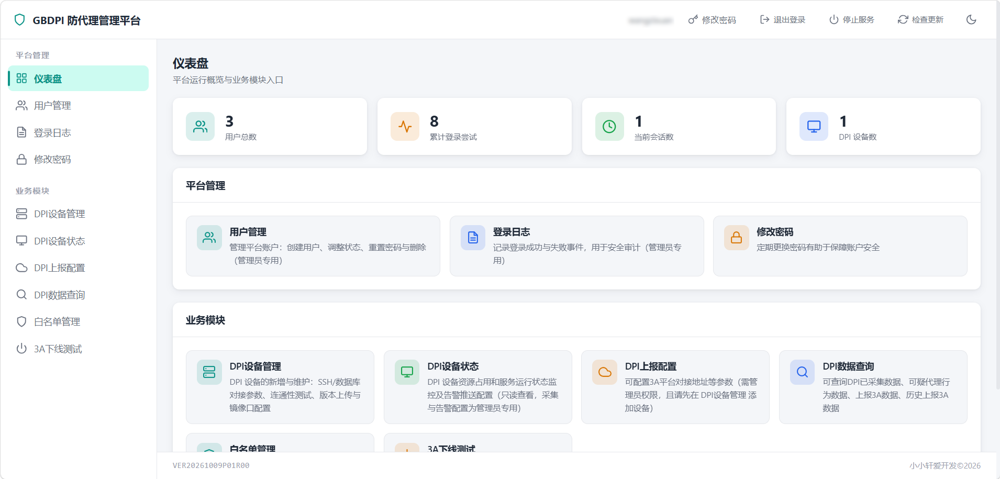
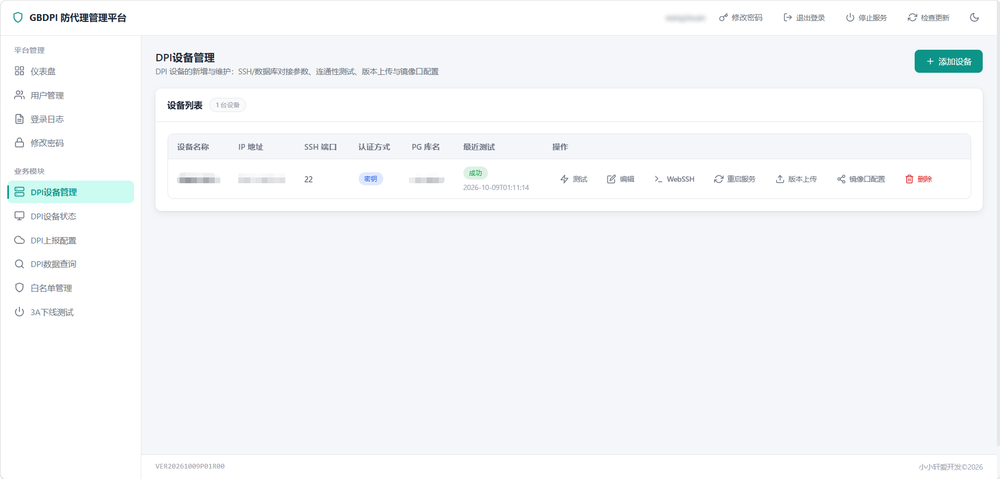
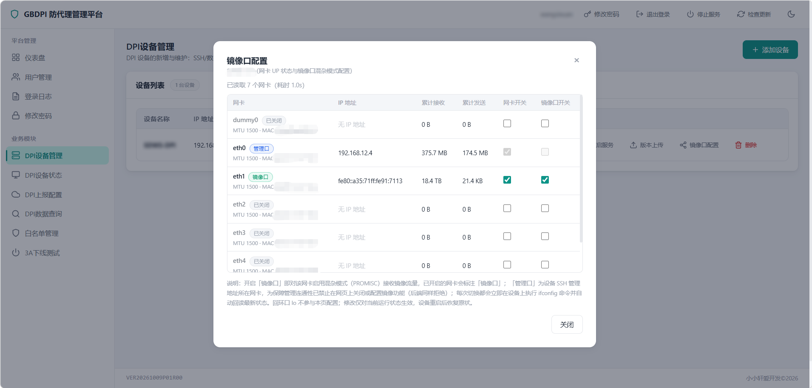
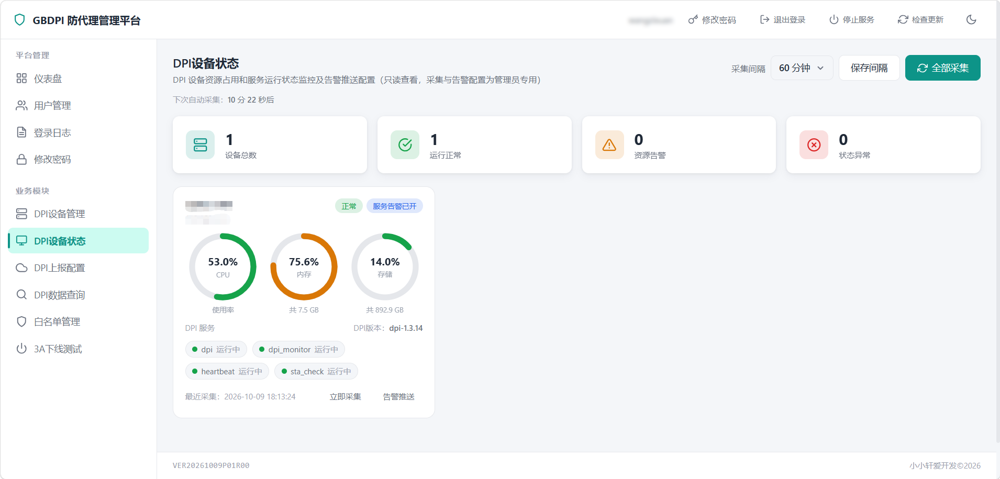
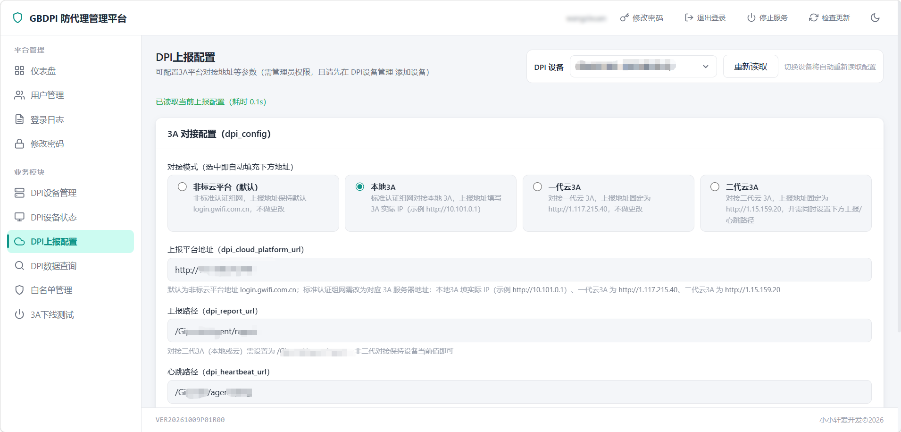
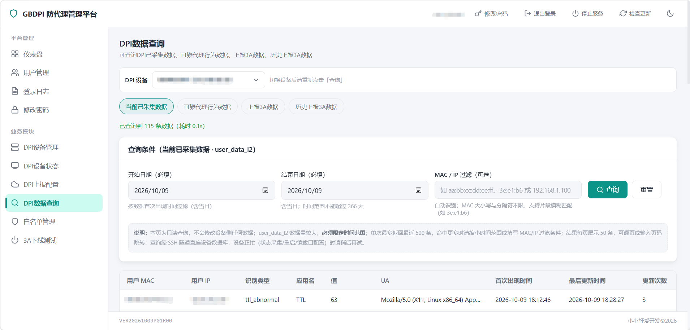
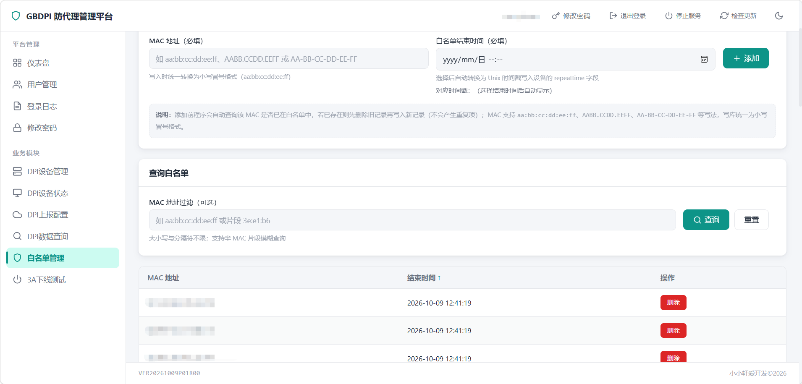
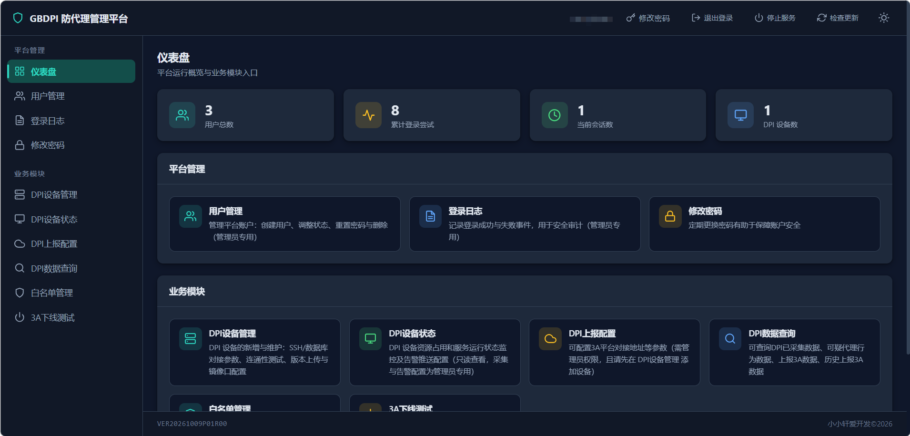

# GBDPI 防代理管理平台

一款面向寰创(GBCOM) DPI（防代理）设备的 Web 集中管控平台。平台经 SSH（自带 direct-tcpip 隧道，无需额外跳板工具）对接设备侧 PostgreSQL，将手册中的本地/云平台地址配置、白名单增删、3A 下线、数据查询等命令操作全部网页化；同时支持 DPI 设备的登记与连通性测试、资源与服务状态监控、多渠道告警推送、上报配置、数据查询、白名单管理、3A 下线测试与定时批量强制下线。

## 功能特性

### 平台管理
- 首次访问自动进入初始化向导，创建管理员账户
- 支持仪表盘总览（用户数、登录次数、在线会话数、设备数）
- 支持用户管理：创建用户、启用/禁用、重置密码、删除（管理员专用）
- 支持登录日志审计：记录登录成功与失败事件、来源 IP 及锁定剩余分钟等详情（管理员专用）
- 支持修改密码、验证码登录、连续失败锁定、会话超时与 CSRF 防护
- 支持顶栏「检查更新」（对比 GitHub Releases 最新版本）与「停止服务」
- 支持浅色/暗色主题切换

### DPI设备管理
- 支持批量登记 DPI 设备，分别配置 SSH 参数、PostgreSQL 对接参数及密码/私钥认证方式
- 支持一键两阶段连通性测试（SSH 连接 → SSH 隧道 → PG 执行 SELECT 1）
- 支持版本文件上传（.bin 固件经 SFTP 上传至设备 /tmp 目录，不做安装/重启）
- 支持镜像口配置与设备重启
- 支持浏览器内 WebSSH 终端操作设备
- 设备凭据加密落盘，编辑时凭据留空即沿用旧值

### DPI设备状态
- 支持定时采集 CPU、内存、存储占用及 DPI 四个服务（dpi / dpi_monitor / heartbeat / sta_check）运行状态
- 支持采集 DPI 软件版本并在设备卡片展示
- 支持手动采集与采集间隔配置
- 支持资源告警（CPU/内存/存储阈值）与服务告警（服务运行 + 设备在线）两路独立开关
- 支持异常出现与恢复各推送一次的状态迁移告警
- 支持 Webhook / 企业微信 / 钉钉 / 飞书 / Server酱 / PushPlus / WxPusher / Bark / Telegram / ntfy / Gotify / 邮件(SMTP) 共 12 种推送渠道

### DPI上报配置
- 支持配置本地 3A / 云平台对接地址等参数（需管理员权限，且请先在 DPI设备管理 添加设备）
- 支持保存后页内「立即重启服务」

### DPI数据查询
- 支持查询当前已采集数据、可疑代理行为数据、上报 3A 数据、历史上报 3A 数据（普通用户只读）
- 支持时间范围过滤（当前已采集数据必填）
- 支持单输入框自动识别过滤条件：完整 MAC 精确匹配、IP 精确匹配、MAC 片段（如 3e:e1:b6）模糊匹配

### 白名单管理
- 支持查询 DPI MAC 白名单（存于设备侧 sta_whitelist_l2 表，普通用户只读）
- 支持添加与删除白名单（管理员专用，不支持修改）
- 添加时结束时间自动转时间戳；同一 MAC 已存在则先删旧记录再写新记录

### 3A下线测试
- 支持单次下线测试：选择设备并输入终端 MAC，经 SSH 在设备本机发送一次带签名的 3A 上报请求并回显 doState 结果
- 支持定时批量强制下线：每任务绑定一台设备 + 一批 MAC + 统一间隔（最小 15 分钟），可启停、修改、立即执行并查看日志
- 两项操作仅用于测试/运维下线，不写白名单、不写上报历史（需管理员权限，且请先在 DPI设备管理 添加设备）

## 快速开始

### 环境要求

- Windows10 及以上版本的操作系统，或 Linux 服务器 / Docker 环境
- 平台需能访问 DPI 设备的 SSH 端口及其侧数据库网络
- 
### 命令行参数

```
用法: python run.py [-a] [-h] [-p PORT] [-4] [-6] [--db-path PATH]

选项:
  -a, --auto-start  注册开机自启动（仅 Windows）
  -h, --hide        隐藏黑窗口静默运行
  -p, --port PORT   Web 监听端口号
  -4                仅监听 IPv4
  -6                仅监听 IPv6
  --db-path PATH    SQLite 数据库文件路径
  --help            显示帮助信息

注: 若不指定 -4 和 -6，或同时指定 -4 -6，则同时监听 IPv4 和 IPv6
```

## 使用流程

1. **初始化平台**：首次部署后访问 Web 页面，按引导创建管理员账户并登录
2. **添加 DPI 设备**：在「DPI设备管理」页面登记设备并配置 SSH / 数据库参数，执行连通性测试确认可达
3. **查看设备状态**：在「DPI设备状态」页面查看资源占用与服务运行情况，按需配置采集间隔与告警推送
4. **执行业务运维**：根据需要在「DPI上报配置」「白名单管理」「3A下线测试」「DPI数据查询」页面完成配置、增删、下线测试与数据查询

## 运行截图
















